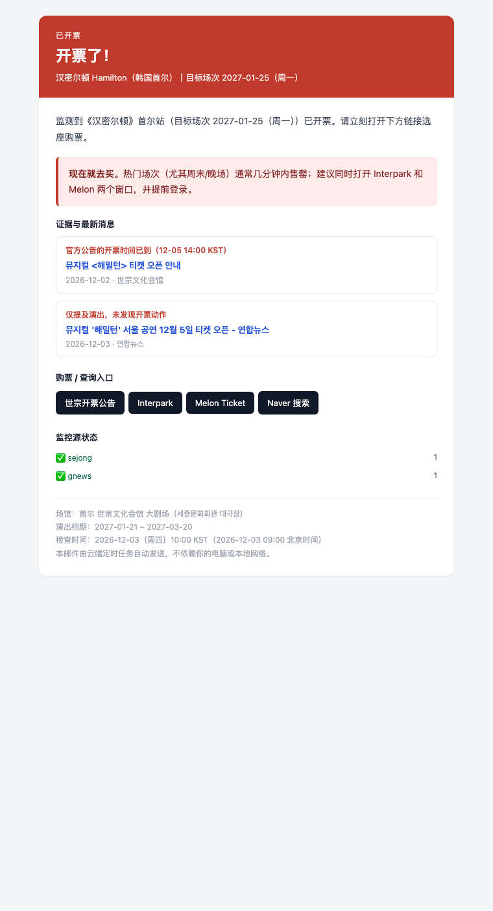

# 汉密尔顿 · 首尔 1/25 抢票监控

一个跑在**云端**的票务监控：盯着《汉密尔顿》韩国首尔站（目标场次 **2027-01-25**）的开票消息。

- **开票了** → 立刻发邮件，附证据和购票链接；
- **公布开票时间了** → 单独发一封预告；
- **一直没开票** → 每 **5 天**发一封进度邮件；
- **监控本身挂了** → 发「监控异常」提醒你。

它跑在 GitHub Actions 上，**不需要你的电脑开机，也不依赖你本机的网络**。本机断网、关机、换网络都不影响。



---

## 目录

- [它是怎么工作的](#它是怎么工作的)
- [10 分钟部署](#10-分钟部署)
- [163 邮箱授权码怎么拿](#163-邮箱授权码怎么拿)
- [配置说明](#配置说明)
- [备用邮件通道](#备用邮件通道)
- [本地运行与测试](#本地运行与测试)
- [文件结构](#文件结构)
- [常见问题](#常见问题)
- [已知限制](#已知限制)

---

## 它是怎么工作的

```
GitHub Actions（云端，每 5 分钟）
   ├── 世宗文化会馆「开票公告」板   ← 最权威，公告自带开票日期时间
   ├── Google News RSS             ← 开票新闻，带发布时间
   ├── Naver 综合搜索              ← 韩国门户，博客/新闻风声
   └── 指定商品页（可选）          ← 拿到 Interpark/Melon 链接后开启
              │
              ▼
        规则判定（保守，避免误报）
              │
              ├── 已开票 ──────────→ 立即发「已开票」邮件
              ├── 已公布开票时间 ──→ 发预告邮件
              ├── 只有相关消息 ────→ 每 5 天汇总一封
              └── 全部源都失败 ────→ 6 小时后发「监控异常」
              │
        state.json（提交回仓库，记住上次发信时间）
```

判定规则（宁可不报，也不把「还没开票」说成「已开票」）：

1. 世宗文化会馆公告板出现《해밀턴》的开票公告，且公告里的**开票时间已到** → 已开票；
2. 公告里的开票时间在未来 → 只发「开票时间公布」；
3. 新闻标题同时出现 `해밀턴` 和 `티켓 오픈 / 예매 오픈 / 예매 시작`，且没有 `예정 / 임박 / 추후 / 가능성` 之类的弱化词 → 近 3 天内的按「已开票」处理；
4. 票务网站（Interpark / Melon / Yes24 / 世宗）出现该演出的商品页 → 发「发现开票信号，请人工确认」；
5. 只提到演出、或只是「预计/可能」 → 只进 5 天进度邮件。

> **延迟说明**：GitHub 的定时任务最短 5 分钟，但高峰期可能延迟几分钟到十几分钟。这是免费方案里比较快的做法；如果你有服务器，也可以把它挂到自己的 crontab 上。

---

## 10 分钟部署

### 1. 建一个 GitHub 仓库

- 打开 <https://github.com/new>；
- 仓库名随意，例如 `hamilton-seoul-watch`；
- 选 **Public**（公开仓库的 Actions 分钟数免费、不限量；私有仓库每月只有 2000 分钟，5 分钟一次的频率会不够用）；
- 不要勾选 "Add a README file"。

### 2. 把本项目传上去

**方式 A：网页上传（不用命令行）**

1. 进入新仓库，点 **Add file → Upload files**；
2. 把本项目文件夹里的**所有文件和文件夹**拖进去。Chrome/Edge 支持直接拖文件夹，但 `.github` 是隐藏目录，macOS 下先按 `Cmd + Shift + .` 让它显示出来；
3. 点 **Commit changes**；
4. 传完后确认仓库根目录能看到 `config.toml`，以及 `.github/workflows/watch.yml`。如果 `.github` 没传上去，Actions 页面不会出现这个 workflow —— 可以在 GitHub 网页上手动 **Add file → Create new file**，文件名填 `.github/workflows/watch.yml`，把本地文件内容粘进去。

**方式 B：命令行**

```bash
cd hamilton-seoul-watch
git init
git add .
git commit -m "init: hamilton seoul ticket monitor"
git branch -M main
git remote add origin https://github.com/<你的用户名>/hamilton-seoul-watch.git
git push -u origin main
```

### 3. 打开 Actions 写权限

仓库 **Settings → Actions → General**：

- "Actions permissions" 选 **Allow all actions and reusable workflows**；
- 页面底部 "Workflow permissions" 选 **Read and write permissions**，保存。
  （监控需要把 `state.json` 提交回仓库，记住上次发邮件的时间。）

### 4. 添加 3 个 Secrets

**Settings → Secrets and variables → Actions → New repository secret**：

| Name | Value |
| --- | --- |
| `MAIL_TO` | `marshall_gefexiang@163.com` |
| `MAIL_USERNAME` | `marshall_gefexiang@163.com` |
| `MAIL_PASSWORD` | 163 邮箱的 **SMTP 授权码**（不是登录密码，见下一节） |

> 仓库是公开的也没关系：邮箱只存在 Secrets 里，不会出现在代码或日志中。

### 5. 先发一封测试邮件

1. 打开仓库的 **Actions** 标签页；
2. 左侧选 **Hamilton Seoul ticket monitor**；
3. 右侧 **Run workflow** → 模式选 `test-email` → 运行；
4. 几十秒后查看 163 邮箱（**包括垃圾箱**）。

收到测试邮件后，再跑一次 `check` 模式，你会收到「监控已启动」。之后它就会每 5 分钟自动检查，不需要你再做任何事。

---

## 163 邮箱授权码怎么拿

1. 电脑浏览器登录 <https://mail.163.com>；
2. 顶部 **设置 → POP3/SMTP/IMAP**；
3. 开启 **SMTP 服务**（需要手机验证）；
4. 按提示获取**授权码**（一串字母数字，只显示一次，记下来）；
5. 把授权码填到 GitHub Secret `MAIL_PASSWORD`。

注意：

- 授权码不是邮箱登录密码，填错会报 `535 Authentication failed`；
- 163 免费邮箱对发信频率有限制，本项目正常每天最多几封，不会触发；
- 如果公司/学校网络限制 465 端口，不影响云端运行（云端不受你本地网络限制）。

---

## 配置说明

所有配置在 [`config.toml`](config.toml)，改完提交即可生效。

| 配置项 | 默认值 | 说明 |
| --- | --- | --- |
| `show.target_date` | `2027-01-25` | 你关心的场次，只影响邮件文案与「目标日期」标记 |
| `monitor.digest_every_days` | `5` | 没开票时，每隔几天发进度 |
| `monitor.digest_hour_kst` | `10` | 进度邮件在韩国时间几点后发（避免半夜） |
| `monitor.re_alert_hours` | `24` | 已开票状态下重复提醒间隔 |
| `monitor.startup_email` | `true` | 首次运行是否发「监控已启动」 |
| `monitor.failure_alert_after_hours` | `6` | 所有源连续失败多久后发异常告警 |
| `notify.provider` | `smtp` | `smtp` / `resend` / `formsubmit` / `none` |
| `notify.smtp_host` | `smtp.163.com` | 换 QQ 邮箱就改成 `smtp.qq.com` |

想改检查频率：编辑 [`.github/workflows/watch.yml`](.github/workflows/watch.yml) 里的 `cron: "*/5 * * * *"`（最短 5 分钟）。

想改目标场次：把 `target_date` 改成 `2027-02-14` 这种格式即可。

想监控具体商品页：拿到 Interpark / Melon 的商品 URL 后，把 `[[source]] type = "page"` 那段改成：

```toml
[[source]]
type = "page"
name = "interpark_goods"
enabled = true
urls = ["https://tickets.interpark.com/goods/26xxxxxx"]
require_keyword = "해밀턴"
open_markers = ["예매하기", "예매중", "BOOK NOW"]
pre_markers = ["예매 오픈 예정", "오픈 예정"]
force_reader = true   # 商品页是 JS 渲染的，强制走阅读器代理
```

---

## 备用邮件通道

如果 163 SMTP 不方便（例如拿不到授权码），可以换：

### Resend（需要注册，免费额度每天 100 封）

1. 用你的邮箱在 <https://resend.com> 注册，创建 API Key；
2. GitHub Secrets 增加 `RESEND_API_KEY`；
3. `config.toml` 里 `provider = "resend"`；
4. 不改 `RESEND_FROM` 时用 `onboarding@resend.dev`，**只能发给注册 Resend 的那个邮箱**。

### FormSubmit（免注册，可靠性一般）

1. `config.toml` 里 `provider = "formsubmit"`；
2. 第一次运行时 FormSubmit 会给你发一封**激活邮件**，点一下链接；
3. 之后才能正常转发。

> 建议优先用 163 SMTP：最直接、最少中间环节。

---

## 本地运行与测试

```bash
cd hamilton-seoul-watch
python3 -m venv .venv && source .venv/bin/activate
pip install -r requirements.txt

# 跑一次检查，只打印、不发邮件、不改状态
MAIL_PROVIDER=none python -m hamilton_watch check --dry-run

# 单元测试
python -m unittest discover -s tests -v
```

本地发真实邮件：

```bash
export MAIL_TO=marshall_gefexiang@163.com
export MAIL_USERNAME=marshall_gefexiang@163.com
export MAIL_PASSWORD='你的授权码'
python -m hamilton_watch test-email
```

其他命令：

```bash
python -m hamilton_watch status      # 查看上次运行状态
python -m hamilton_watch digest      # 强制发一封进度邮件
python -m hamilton_watch check -v    # 带调试日志
```

---

## 文件结构

```
hamilton-seoul-watch/
├── config.toml                 # 目标场次、间隔、信息源、邮件通道
├── requirements.txt
├── hamilton_watch/
│   ├── __main__.py             # python -m hamilton_watch
│   ├── run.py                  # 主流程：抓取 → 判定 → 发信
│   ├── detect.py               # 开票判定规则
│   ├── config.py               # 配置加载（环境变量优先）
│   ├── fetch.py                # HTTP 抓取 + 阅读器代理兜底
│   ├── notify.py               # SMTP / Resend / FormSubmit
│   ├── report.py               # 邮件排版（纯文本 + HTML）
│   ├── state.py                # state.json 读写
│   ├── timeutil.py             # KST/北京时间处理
│   └── sources/
│       ├── sejong.py           # 世宗文化会馆开票公告板
│       ├── google_news.py      # Google News RSS
│       ├── naver.py            # Naver 综合搜索
│       └── page.py             # 通用页面监控
├── tests/                      # 单元测试 + 固定样本
├── docs/                       # 邮件效果图
└── .github/workflows/watch.yml # 定时任务
```

---

## 常见问题

**Q：测试邮件没收到？**

- 先看 163 的垃圾箱/广告邮件；
- 看 GitHub Actions 的运行日志，是否有 `535`（授权码错）或 `MAIL_PASSWORD` 为空；
- 确认 GitHub Secrets 的名字是 `MAIL_TO`、`MAIL_USERNAME`、`MAIL_PASSWORD`，大小写一致。

**Q：Actions 会准时每 5 分钟跑吗？**

GitHub 的 cron 是「尽力而为」，高峰期可能延迟 5–20 分钟，偶尔会跳过某一次。监控逻辑不依赖精确时间，下一次运行会补上。

**Q：公开仓库会不会泄露我的邮箱？**

不会。邮箱只存在 GitHub Secrets 里；`config.toml` 的 `to` 默认为空。`state.json` 里只有链接和时间。

**Q：仓库 60 天没人操作，Actions 会被停用吗？**

公开仓库的定时任务在 60 天无活动后会被停用。本项目每次发信/每 6 小时会提交一次 `state.json`，这算仓库活动，所以不会被停。

**Q：会不会误报「已开票」？**

规则偏保守：官方公告以公告自带的时间为准；新闻必须有明确的开票动词且没有「预计/可能」等弱化词。仍然建议收到邮件后点开链接确认——邮件里就是购票入口。

**Q：页面改版了怎么办？**

邮件里附了「监控源状态」，哪个源失败会显示。到 `config.toml` 里调整，或临时把对应源 `enabled = false`。世宗公告板是最稳的源，改版概率低。

**Q：怎么停掉？**

Actions 页面右上角 **⋯ → Disable workflow**；或者删除仓库。

---

## 已知限制

- 本项目只做**通知**，不代购、不抢票、不绕过任何验证码；
- 韩国票务网站有反爬/排队机制，抓取可能失败；失败会触发「监控异常」而不是静默；
- 开票瞬间网站可能排队，邮件到达时也不保证还有票；建议收到预告后提前登录、绑定支付方式；
- 演出信息以官方公告为准。当前公开信息：釜山 2026-12-17 ~ 2027-01-16（드림씨어터），首尔 2027-01-21 ~ 2027-03-20（세종문화회관 대극장），开票时间待公布。

参考来源：[뉴스핌 报道](http://m.newspim.com/news/view/20261012001294)、[서울문화투데이](https://www.sctoday.co.kr/news/articleView.html?idxno=48760)。

---

## 数据来源

- 世宗文化会馆开票公告：<https://www.sejongpac.or.kr/portal/bbs/B0000049/list.do?menuNo=200440>
- Interpark Ticket 搜索：<https://tickets.interpark.com/search?keyword=해밀턴>
- Melon Ticket 搜索：<https://ticket.melon.com/search/index.htm?keyword=해밀턴>
- Naver 搜索：<https://search.naver.com/search.naver?query=해밀턴+예매>
- Google News：<https://news.google.com/search?q=해밀턴+티켓&hl=ko&gl=KR&ceid=KR:ko>

---

*非官方工具，与制作方/票务平台无关。*
